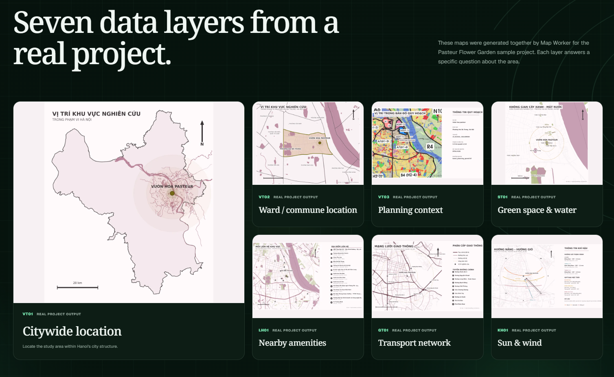
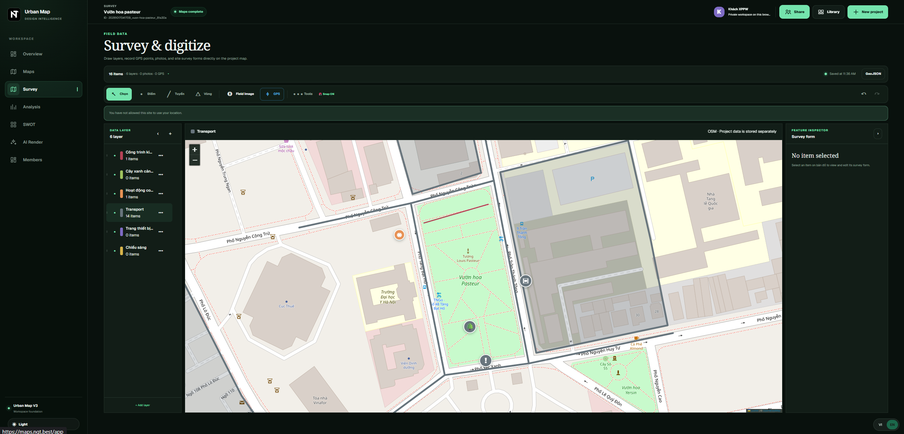
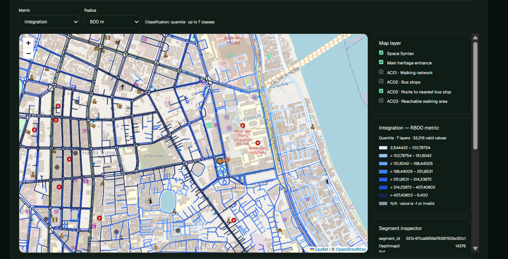
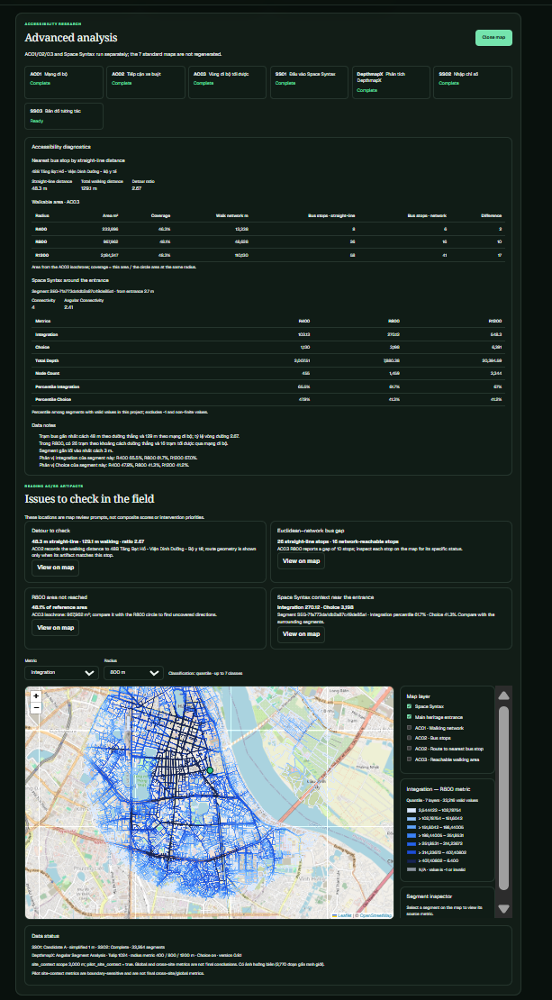
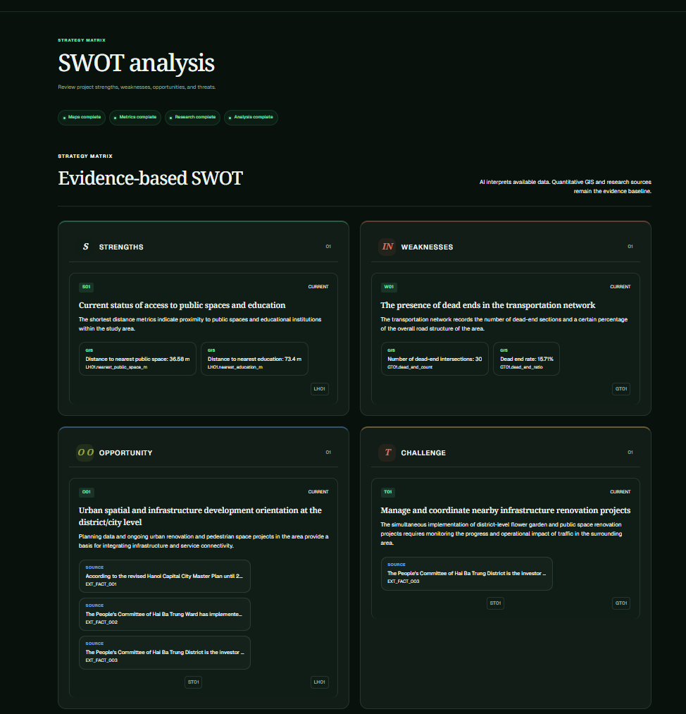

# Urban Map — Automated GIS, Space Syntax & AI Urban Design Intelligence

> This repository publishes reusable GIS metric functions, a privacy-conscious GeoJSON normalizer, a metric payload contract, and a safe local depthmapXcli wrapper. It does not publish the production web application, authentication services, database configuration, deployment secrets, or private survey data.

## Overview

Urban Map is a free-to-access urban analysis platform developed at Hanoi Architectural University (HAU). It helps urban design students, architects, and climate researchers automate site-analysis workflows from a study-area location.

The production platform combines standardized GIS outputs, Space Syntax analysis, walkability diagnostics, field survey tools, and evidence-linked design insights. This repository contains selected, standalone technical modules that can be inspected and reused without the private application stack. Explore the live service at [maps.nqt.best](https://maps.nqt.best).

## Core Features

### Seven standardized GIS map layers

The application organizes analysis into seven map layers: VT01–03, ST01, LH01, GT01, and KH01. These cover context and planning, blue-green cover, amenities, street networks, and sun-and-wind conditions.

Representative outputs from the Pasteur Flower Garden sample include **8.7% green coverage** in ST01 and **12.6 km/km² road density** in GT01. They describe one study-area run, not universal benchmarks.

### Headless Space Syntax and walkability diagnostics

The production pipeline uses depthmapXcli for headless Space Syntax workflows. A documented network contains 33,216 street segments and is evaluated at R400, R800, and R1200. AC01–03 diagnostics add network reachability and walkable isochrones.

One representative 800 m sample reports 26 bus stops inside a Euclidean radius and 16 reachable on the walking network, a 2.67 detour ratio, and a 15.71% dead-end share. These values depend on the study boundary and source snapshot.

### Interactive field survey and digitization

The application supports browser GPS, point/line/polygon drawing, six survey layers, and GeoJSON export. The public package validates Point, LineString, and Polygon FeatureCollections, bounds feature and vertex counts, normalizes finite WGS84 coordinates, closes polygon rings, and keeps valid feature properties. It does not upload, store, or anonymize survey data.

### Evidence-based SWOT matrix

AI-generated SWOT strategies link GIS claims to metrics such as LH01, GT01, and ST01. Planning-document claims carry source references such as EXT_FACT, so a reviewer can trace a statement back to a metric or cited source.

## Technical modules

| Module | Purpose | Optional dependencies |
| --- | --- | --- |
| urban_map_public.geojson | Validate and canonicalize survey FeatureCollections | None |
| urban_map_public.depthmapx | Run a local CLI with argument-list semantics, a timeout, and a reduced environment | depthmapXcli installed separately |
| urban_map_public.metrics.traffic | Calculate GT01 road length, road density, and intersection metrics from an existing OSMnx graph | GIS extra |
| urban_map_public.metrics.connectivity | Calculate physical graph topology within an optional study-area geometry | GIS extra |
| urban_map_public.metrics.blue_green | Calculate ST01 green and water coverage from polygon datasets | GIS extra |
| urban_map_public.metrics.schema | Validate versioned metric names, units, and map status | schema extra |

The analytics functions consume already-loaded geometries or graphs. They do not download OSM data, access a database, make network requests, or write user data to disk.

## GIS methodology

### ST01 blue-green coverage

The ST01 function requires a valid, positive-area study geometry in a projected CRS whose horizontal units are metres. Each source GeoDataFrame must declare its CRS. Source features are transformed to the target CRS when needed, repaired where possible, intersected with the study boundary, and dissolved by layer before area is measured. Dissolving prevents overlapping source polygons from inflating coverage.

For study area A, green union G, and water union W:

- Green coverage (%) = 100 × area(G) / area(A)
- Water coverage (%) = 100 × area(W) / area(A)
- Feature counts include valid clipped source features; linear water features can count as features while contributing zero polygon area.

Returned area values are square metres and percentage values are in the range 0–100 when geometries are valid and in the same projected CRS.

~~~python
import geopandas as gpd
from shapely.geometry import box

from urban_map_public.metrics import calculate_st01_blue_green_metrics

# Synthetic local UTM coordinates; this example does not load real survey data.
study = box(500_000, 2_300_000, 501_000, 2_301_000)
green = gpd.GeoDataFrame(
    {"source": ["synthetic-canopy"]},
    geometry=[box(500_000, 2_300_000, 500_200, 2_300_200)],
    crs="EPSG:32648",
)

result = calculate_st01_blue_green_metrics(
    study_area=study,
    study_crs="EPSG:32648",
    green_gdf=green,
    water_gdf=None,
)
print(result["metrics"]["green_percent"])  # 4.0
~~~

### GT01 street network metrics

The GT01 function accepts a directed OSMnx MultiDiGraph and a polygon in the graph's projected CRS. It copies the graph, adds deterministic fallback OSM IDs for missing IDs, converts mirrored directed edges to a physical undirected network, derives edge geometry from endpoint coordinates when an edge geometry is absent, clips each edge to the study area, and sums projected lengths by road class.

The reported road density is total clipped road length in kilometres divided by study-area square kilometres. Intersection candidates are graph nodes covered by the boundary with OSMnx physical street count at least three. Invalid geometries are repaired when possible; zero-area study regions, geographic CRSs, and projected CRSs whose horizontal units are not metres are rejected. Unknown road classes are conservatively grouped as local.

~~~python
import networkx as nx
from shapely.geometry import LineString, box

from urban_map_public.metrics import calculate_gt01_traffic_metrics

graph = nx.MultiDiGraph(crs="EPSG:32648")
graph.add_node(1, x=500_000, y=2_300_000)
graph.add_node(2, x=500_100, y=2_300_000)
geometry = LineString([(500_000, 2_300_000), (500_100, 2_300_000)])
graph.add_edge(1, 2, key=0, osmid=42, highway="residential", geometry=geometry)
graph.add_edge(2, 1, key=0, osmid=42, highway="residential", geometry=geometry)

def classify_road(highway):
    values = set(highway) if isinstance(highway, (list, tuple, set)) else {highway}
    if values & {"motorway", "trunk", "primary"}:
        return "major"
    if values & {"secondary", "tertiary"}:
        return "secondary"
    return "local"

result = calculate_gt01_traffic_metrics(
    graph=graph,
    study_area=box(499_950, 2_299_950, 500_150, 2_300_050),
    road_classifier=classify_road,
)
print(result["total_road_length_km"])  # mirrored edges are counted once
~~~

Road-class policy is supplied by the caller because classification depends on the study's analytical convention. The function returns total, major, secondary, and local road length, road density, intersection count, and intersection density.

### Physical network topology

The connectivity function reports node and edge counts, average physical degree, degree-one node count and ratio, and connected component count. When a study polygon is provided, it first selects covered nodes and analyzes the induced subgraph, preventing nodes outside the analysis boundary from expanding the topology summary.

A physical graph collapses reverse-direction representations of the same OSM street while keeping true parallel streets separate. In schema version 1.1, connectivity metrics are represented alongside GT01 metrics; the function name retains its historical KH01 name for compatibility with the analysis pipeline.

~~~python
from urban_map_public.metrics import calculate_kh01_connectivity_metrics

topology = calculate_kh01_connectivity_metrics(
    graph,
    study_area=box(499_950, 2_299_950, 500_150, 2_300_050),
)
print(topology["dead_end_ratio"])
~~~

Graph node coordinates and the optional study boundary must use the same CRS. The topology calculation does not measure distances, so a projected CRS is not required for topology alone. The connectivity helper operates on the supplied graph; it does not download or route across a network.

### Versioned metric payload contract

The optional schema module provides strict Pydantic models for map status, finite numeric values, canonical metric names, and units. A canonical document contains ST01, LH01, GT01, and KH01 map sections. Unknown metrics, incorrect units, extra fields, non-finite numbers, and invalid status/error combinations are rejected.

Schema 1.1 deliberately contains only the map metrics and their status. It omits project names, exact coordinates, entrances, account data, and raw source features.

~~~python
from urban_map_public.metrics.schema import MetricsDocument

payload = {
    "schema_version": "1.1",
    "maps": {
        "ST01": {
            "status": "success",
            "metrics": {
                "green_percent": {"value": 4.0, "unit": "%"},
            },
        },
        "LH01": {"status": "not_available", "metrics": {}},
        "GT01": {"status": "not_available", "metrics": {}},
        "KH01": {"status": "not_available", "metrics": {}},
    },
}
validated = MetricsDocument.model_validate(payload)
~~~

## GeoJSON validation and CLI execution

The GeoJSON helper accepts FeatureCollections with Point, LineString, and Polygon features. Defaults limit a collection to 10,000 features, 100,000 vertices, and 64 KiB of properties per feature. Coordinates must be finite longitude/latitude values within WGS84 bounds; polygon rings are closed if needed. Feature IDs and JSON-compatible properties are preserved. Because IDs, properties, and coordinates are retained, callers remain responsible for removing personal or sensitive survey content before sharing.

The depthmapXcli wrapper accepts an explicit executable or resolves DEPTHMAPX_CLI_PATH/PATH. It passes arguments as a sequence with shell execution disabled, closes stdin, captures output, enforces a finite timeout, and passes only a small allowlist of common runtime environment variables to the child process. Install and license the external executable separately.

~~~python
from urban_map_public import normalize_feature_collection, run_depthmapx

survey = {
    "type": "FeatureCollection",
    "features": [{
        "type": "Feature",
        "geometry": {"type": "Point", "coordinates": [0, 0]},
        "properties": {"layer": "observation", "condition": "good"},
    }],
}
canonical = normalize_feature_collection(survey)

result = run_depthmapx(["-v"])
print(result.stdout.strip())
~~~

## Screenshots

*Seven standardized map layers generated for a single study area.*

*Field teams record point, line, and polygon observations directly on the map.*

*Space Syntax outputs summarize segment analysis at multiple metric radii.*

*Network reachability and isochrones reveal practical walking access.*

*Each SWOT statement links to a GIS metric or a cited planning fact.*

## System architecture

The production workflow is containerized and separates interactive UI, job orchestration, geospatial calculation, and Space Syntax execution:

~~~text
Browser
  └── Frontend
        └── Backend API and job orchestration
              └── Python GIS Map Worker
                    ├── OpenStreetMap and planning-data processing
                    ├── ST01 / LH01 / GT01 / KH01 analysis outputs
                    ├── GeoJSON survey validation and accessibility diagnostics
                    └── depthmapXcli for headless Space Syntax analysis
~~~

The public Compose file is an integration template. It expects locally built Map Worker and depthmapXcli images, and it does not contain the production service source or binaries. The Map Worker image must provide depthmapXcli at DEPTHMAPX_CLI_PATH. Put authentication and a reverse proxy in front of any internet-facing worker.

## Installation and run

Python 3.11 or later is required. Install only the dependency-free helpers:

~~~bash
python -m venv .venv
python -m pip install -e .
~~~

Install the GIS and schema extras to use all metric functions:

~~~bash
python -m pip install -e ".[gis,schema]"
~~~

The GIS extra pins OSMnx 2.1.1, which provides the graph conversion and street-count operations used by GT01 and topology calculations. The schema extra installs Pydantic 2. To run the CLI helper, install a compatible depthmapXcli binary separately and set its location:

~~~bash
export DEPTHMAPX_CLI_PATH=/usr/local/bin/depthmapXcli
python -c "from urban_map_public import run_depthmapx; print(run_depthmapx(['-v']).stdout)"
~~~

On PowerShell:

~~~powershell
$env:DEPTHMAPX_CLI_PATH = "C:\tools\depthmapXcli.exe"
~~~

The Compose template uses local images that are not included here. Copy .env.example to .env, build or obtain those images, then review the file before starting:

~~~bash
docker compose -f docker-compose.example.yml config
docker compose -f docker-compose.example.yml up -d map-worker
docker compose -f docker-compose.example.yml run --rm depthmapx-cli -v
~~~

The Compose services demonstrate image wiring and volume isolation; they are not a turnkey production deployment.

## Data attribution

Urban Map outputs using OpenStreetMap data should credit **© OpenStreetMap contributors** and link to the [OpenStreetMap copyright and license page](https://www.openstreetmap.org/copyright). OpenStreetMap data is licensed under the Open Database License (ODbL), separate from the MIT license for this code.

Planning datasets and depthmapXcli may have their own terms. Review them before redistributing source data, rendered results, or binaries.

## Security and privacy

- Never commit a real .env file, API key, database credential, access token, private survey, or unredacted project artifact.
- The .gitignore excludes common secret files, local environment files, raw geospatial exports, and generated artifacts. Review every staged file before publishing; ignore rules do not remove files already tracked by Git.
- .env.example contains local image names, a port, and a CLI path only; it contains no credentials.
- The GeoJSON normalizer preserves feature IDs, properties, and coordinates. It validates structure, but it does not anonymize data.
- The public metrics schema intentionally excludes project metadata and exact study coordinates. Metric outputs can still be sensitive in context; inspect them before sharing.

## License

Code in this repository is distributed under the MIT License. See [LICENSE](LICENSE). The depthmapXcli executable and third-party datasets remain under their own licenses.

